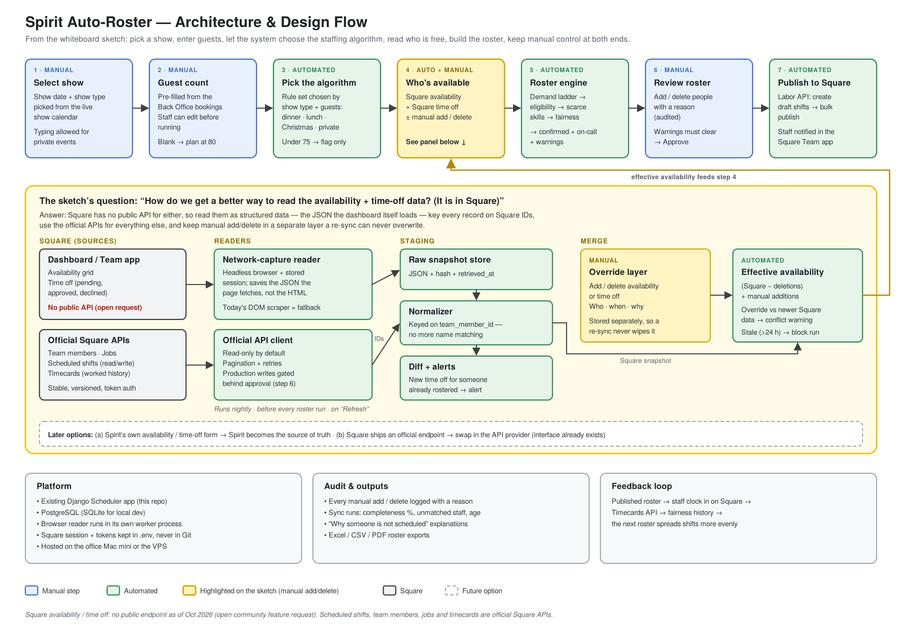
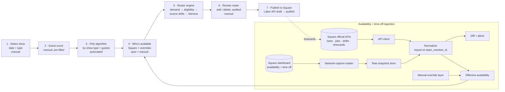

# Spirit Auto-Roster — Architecture & Design

Design for the next stage of the Spirit Scheduler: turn a show date and guest count into a
roster with minimal hand work, while keeping manual control at the two points the
whiteboard sketch calls out.



*Source: [`architecture.svg`](architecture.svg) · Original sketch: [`original-sketch.jpg`](original-sketch.jpg)*

---

## 1. What the sketch says

| # | Step | Mode | Note on the sketch |
|---|------|------|--------------------|
| 1 | Select show date + show type | Manual input | "type in (show type)" |
| 2 | Number of guests | Manual input | |
| 3 | System decides which algorithm to use | Automated | |
| 4 | Look into the **availability sheet + time-off sheet** | Automated | Highlighted: *manual add / deletion should be implemented* |
| 5 | Roster — system puts people on schedule based on the algorithm | Automated | *Manual add / deletion should be possible* |

**The open question (starred on the sketch):**
> How do we get a better way to read the availability + time-off data? (It is in Square.)

---

## 2. The answer

### The constraint

Square publishes **no public API for team availability or time-off requests**. Its Labor
API covers *scheduled shifts* and *timecards* only. A community feature request for
availability/time-off endpoints (opened April 2026) is still open with no Square response
as of October 2026, and Square staff have confirmed the gap on the developer forum.

The current app works around this by driving a logged-in browser through the dashboard
pages and parsing the rendered HTML (`scheduling/integrations/square_availability/live_provider.py`,
`square_time_off/live_provider.py`). That works, but it is slow (15-minute timeout), breaks
when Square redesigns a page, and matches people by name, which leaves "unmatched" staff.

### Options considered

| Option | Reliability | Effort | Verdict |
|---|---|---|---|
| A. Keep scraping the rendered HTML (today) | Low — breaks on any UI change; name matching | None | Keep only as fallback |
| **B. Capture the dashboard's own JSON** while the page loads | Medium-high — structured data with Square IDs; survives visual redesigns | Small (reuses the stored session + Playwright worker) | **Recommended now** |
| C. Manual CSV export / upload | High but manual every week | Low | Emergency fallback only |
| D. Spirit's own availability & time-off form | High — Spirit owns the data | Medium + staff change-management | **Recommended later** |
| E. Wait for an official Square endpoint | Highest | None | Swap in when it ships |

### Recommendation

1. **Read structured data, not pixels.** The dashboard's availability and time-off pages
   are web apps that fetch their data as JSON. The reader opens those pages with the stored
   session and saves the JSON responses (Playwright `page.on("response")`) instead of
   parsing the table. Every record then carries Square's `team_member_id`, so mapping to
   our employees is exact — no name matching.
   *First task is a spike to record which requests those two pages make and confirm the
   payload shape.* The current HTML parser stays as the fallback path.
2. **Use official APIs for everything Square does expose** — team members, jobs, scheduled
   shifts (read and, after approval, write) and timecards (fairness history).
3. **Snapshot → normalize → diff.** Each read stores the raw JSON with a hash and
   timestamp, normalizes to the existing `NormalizedAvailabilityRecord`, and diffs against
   the previous snapshot. New approved time off for someone already on a roster raises an
   alert.
4. **Manual override layer** (the highlighted ask). Manual adds/deletes live in their own
   table and are applied on top of the Square snapshot, so a re-sync never wipes them:

   ```
   effective availability = (Square snapshot − manual deletions) + manual additions
   ```

   If newer Square data contradicts an override (e.g. Square now shows approved time off
   where a manager added "available"), the run raises a conflict warning instead of
   silently picking one.
5. **Freshness rule.** Sync nightly, before every roster run and on a "Refresh" button. If
   the newest snapshot is older than 24 hours, block the automatic run and ask for a
   refresh.
6. **Swap-ready.** The provider interface already exists (`BaseAvailabilityProvider`,
   `APIAvailabilityProvider`). When Square ships an endpoint, or Spirit moves to its own
   form, only the provider changes.

---

## 3. End-to-end flow



### Step 3 — algorithm selection

| Show type | Rule set |
|---|---|
| Dinner show | Existing staffing ladder (see `docs/ranking_logic.md`) |
| Lunch | Lunch ladder (smaller crew) |
| Christmas season | Dinner ladder; full-house assumptions |
| Private event / group booking | Event-specific template |
| Any show under 75 guests | No roster — flag for management |

---

## 4. Data model additions

| Model | Key fields | Purpose |
|---|---|---|
| `SquareRawSnapshot` | kind (availability / time_off), payload JSON, hash, retrieved_at, provider | Raw evidence of every read |
| `AvailabilityOverride` | employee, date, start/end time, action (add / delete), kind (availability / time_off), reason, created_by, created_at, active | Manual layer, never touched by sync |
| `AvailabilityConflict` | override, snapshot, detail, resolved_by | Override vs newer Square data |

`EmployeeAvailability` / `EmployeeTimeOff` remain the normalized Square view.

---

## 5. Build plan

| Phase | Work | Done when |
|---|---|---|
| 0 | Spike: record the network calls on the availability + time-off pages | Payload shape documented, IDs confirmed |
| 1 | Network-capture reader + raw snapshot store; HTML parser as fallback | Sync completes in under a minute with 100% ID matches |
| 2 | Override layer + effective-availability merge + conflict warnings | Re-sync keeps every manual edit; conflicts surfaced |
| 3 | Algorithm selector by show type | Each show type picks its rule set; tests cover each |
| 4 | Diff alerts + freshness gate + nightly schedule | Stale data blocks auto-run; new time off on a rostered person alerts |
| 5 | Publish approved roster via Labor API (draft → bulk publish) | Production write only after approval in step 6 |
| Later | Spirit self-service availability form, or official Square endpoint | Provider swapped, no engine changes |

## Build status

**Phase 1 — built** (branch `auto-roster-phase-1`):

| Piece | Where |
|---|---|
| Manual change layer (`AvailabilityOverride`): add/remove per date, reason required, who/when kept, never touched by a Square refresh | `scheduling/models.py`, `scheduling/services/overrides.py` |
| Overrides applied in availability, eligibility and the "missing availability" count | `services/availability.py`, `services/eligibility.py`, `services/engine.py` |
| Conflict handling: time off approved after an addition blocks until someone picks *Keep my change* or *Use Square's* | `services/overrides.py`, roster step 4 |
| Step 3 rule selection by show type (workshop, offsite, under 75, private, Dwight's, regular evening, own timetable) — engine now asks this one function, behaviour unchanged | `services/show_profiles.py` |
| Freshness gate: Square availability older than 24 h blocks a build unless deliberately overridden (noted on the run) | `services/freshness.py` |
| Screens: **Schedules → Build a roster for one show** (steps 1–3) and **Who's available** (step 4), handing over to the existing review page (5–6) and Square draft sync (7) | `scheduling/roster_views.py`, `templates/scheduling/roster_*.html` |

Not yet: the network-capture reader (needs a signed-in Square session to record what the
dashboard loads — Phase 0 spike), Back Office guest-count pre-fill, nightly schedule, and
one-click publish (the app still sends drafts only, by design).

## 6. Open decisions

- Should staff keep entering availability in the Square Team app, or move to a Spirit form (Option D)?
- Who may create overrides — managers only, or the office too?
- Which show types need their own staffing ladder beyond dinner?
- Is the 24-hour freshness limit right, or should it be shorter in Christmas season?

## Sources

- [Square — Scheduling with the Labor API](https://developer.squareup.com/docs/labor-api/scheduling)
- [Square Community — Staff Availability / Time Off API Endpoints (feature request)](https://community.squareup.com/t5/Feature-Requests/Staff-Availability-Time-Off-API-Endpoints/idc-p/850601)
- [Square Developer Forums — Getting availability data of team members](https://developer.squareup.com/forums/t/getting-availability-data-of-team-members/11617/2)
- [Square Community — Introducing time off reports](https://community.squareup.com/t5/Product-Updates/Introducing-time-off-reports/ba-p/744350)
- [Square Support — Manage schedule requests](https://squareup.com/help/ca/en/article/8388)
